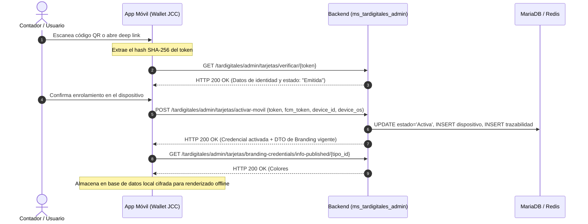
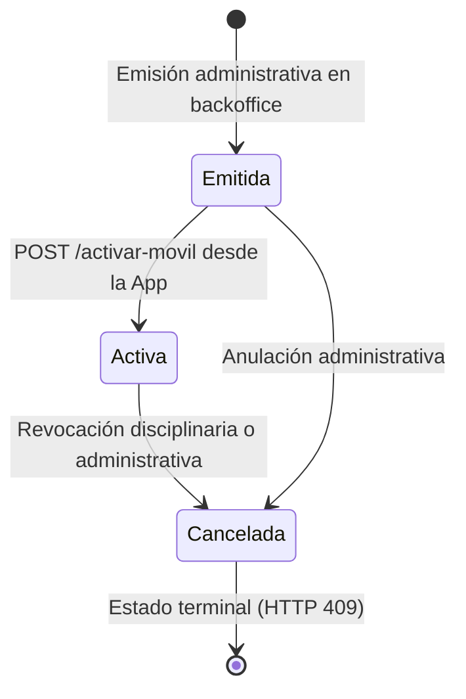

# Guía de Integración API - Aplicación Móvil (Wallet JCC)

> **Microservicio:** `ms_tardigitales_admin`  
> **Host Base (Gateway):** `http://<host>:<puerto>` (ej. `http://localhost:80` o dominio institucional)  
> **Prefijo Obligatorio:** `/tardigitales/admin`  
> **Versión del Contrato:** 1.0.0 (Octubre 2026)

---

## 1. Visión General del Flujo Móvil

La aplicación móvil **Wallet JCC** interactúa con este microservicio para la verificación de tokens criptográficos, enrolamiento de dispositivos físicos, sincronización de la identidad visual vigente (Branding) y obtención del documento binario PDF oficial.



---

## 2. Catálogo de Endpoints para la Aplicación Móvil

Todos los endpoints deben ser invocados anteponiendo el prefijo `/tardigitales/admin`:

| Método | Ruta Relativa | Parámetros Clave | Código Éxito | Función Técnica |
| :---: | :--- | :--- | :---: | :--- |
| `GET` | `/tarjetas/verificar/{token}` | `token` en path (Hash SHA-256) | `200 OK` | Consulta técnica de los datos del contador/sociedad y estado de la tarjeta antes de activar. |
| `POST` | `/tarjetas/activar-movil` | Body JSON (`token`, `fcm_token`, `device_id`, etc.) | `200 OK` | Transiciona el estado de `Emitida` a `Activa` y registra el dispositivo en la tabla satélite. |
| `GET` | `/tarjetas/branding-credentials/info-published/{tipo_id}` | `tipo_id`: `1` (Contador) o `2` (Sociedad) | `200 OK` | Entrega los activos gráficos Base64 oficiales y colores de la tarjeta para visualización en pantalla. |
| `GET` | `/tarjetas/branding-institucional/info-published` | Opcional: `client_id` | `200 OK` | Entrega el nombre, cargo y firma Base64 de la autoridad oficial vigente de la JCC. |
| `GET` | `/tarjetas/verificar/{token}/pdf` | `token` en path (Hash SHA-256) | `200 OK` (`application/pdf`) | Retorna el stream binario del PDF oficial con firma y estampado cronológico. |

---

## 3. Especificación Técnica de los Endpoints

### 3.1. Consulta de Credencial por Token
Consulta el estado de una tarjeta a partir de su hash SHA-256 obtenido del código QR o enlace de activación.

```http
GET /tardigitales/admin/tarjetas/verificar/{token} HTTP/1.1
Host: <host>
Accept: application/json
```

#### Parámetros
- **`token`** *(Path, string, obligatorio)*: Código hash SHA-256 de 64 caracteres alfanuméricos.
- **`client_id`** *(Query, int, opcional)*: Identificador de la entidad cliente (default `20001`).

#### Respuesta Exitosa (`HTTP 200 OK` - Ejemplo Real Contador)
```json
{
  "id": 192,
  "no_tarjeta": "320720-T",
  "no_documento": 1152456369,
  "tipo_documento": "CC",
  "nombres": "LESDI KATERINE",
  "primer_apellido": "AGUDELO",
  "segundo_apellido": "HIGUITA",
  "nombre_completo": "LESDI KATERINE AGUDELO HIGUITA",
  "no_expd": 375883,
  "tipo_asociado": "primeraVez",
  "fecha_emision": "2026-10-21 04:40:50",
  "correo": "kateagudelo2@hotmail.com",
  "universidad": "FUNDACION UNIVERSITARIA LUIS AMIGO - FUNLAM",
  "estado_tarjeta": "Emitida",
  "fecha_activacion": null,
  "estado_contador": "ACTIVO",
  "resolucion": "0001",
  "fecha_resolucion": "2024-01-17",
  "seccional": "MEDELLIN",
  "hash_sha256": "fb98bcc7ef3167edae16559c4d04b1ffe663735108db2bad5ff6c741b1ef6898",
  "tipo_tarjeta": "contadores"
}
```

#### Respuestas de Error
- **`HTTP 404 Not Found`**: Cuando el hash suministrado no existe en el registro central.

---

### 3.2. Activación Móvil y Registro de Dispositivo
Enrola el dispositivo físico del usuario en la base de datos, asocia su identificador de notificaciones push FCM y cambia el estado formal a `Activa`.

```http
POST /tardigitales/admin/tarjetas/activar-movil HTTP/1.1
Host: <host>
Content-Type: application/json
Accept: application/json
```

#### Cuerpo de la Petición (`ActivacionMovilRequestSchema`)
```json
{
  "token": "4a7d8c9e0f1b2c3d4e5f6a7b8c9d0e1f2a3b4c5d6e7f8a9b0c1d2e3f4a5b6c7d",
  "client_id": 20001,
  "fcm_token": "eK3xZ_device_fcm_token_string_here...",
  "device_id": "c4b3a2d1-e5f6-7a8b-9c0d-1e2f3a4b5c6d",
  "device_os": "android",
  "device_modelo": "Samsung Galaxy S23",
  "app_version": "1.2.0"
}
```

| Campo | Tipo | Obligatorio | Descripción Técnica |
| :--- | :--- | :---: | :--- |
| **`token`** | `string` | **Sí** | Hash SHA-256 que identifica la credencial. |
| **`client_id`** | `int` | No | ID de la entidad cliente (default `20001`). |
| **`fcm_token`** | `string` | No | Registration token de Firebase Cloud Messaging para recepción de notificaciones Push. |
| **`device_id`** | `string` | No | Identificador único de hardware (UUID / Android ID / IDFV). |
| **`device_os`** | `string` | No | Plataforma: `"android"` o `"ios"`. |
| **`device_modelo`**| `string` | No | Nombre del modelo del hardware (ej. `"Pixel 8"`, `"iPhone 15"`). |
| **`app_version`** | `string` | No | Versión semántica de la aplicación instalada. |

#### Respuesta Exitosa (`HTTP 200 OK`)
```json
{
  "success": true,
  "mensaje": "Credencial digital activada exitosamente en el dispositivo móvil.",
  "data": {
    "tarjeta": {
      "id": 1502,
      "matricula": "123456-T",
      "documento": "1020304050",
      "nombre_completo": "JUAN CARLOS PEREZ GOMEZ",
      "estado": "Activa",
      "estado_tarjeta": "Activa",
      "fecha_activacion": "2026-10-29 10:45:00",
      "tipo_tarjeta": "contadores"
    },
    "branding": {
      "tipo_id": 1,
      "version": 3,
      "color_fondo": "#0b2240",
      "color_letra": "#FFFFFF",
      "logo": "data:image/svg+xml;base64,...",
      "patron": "data:image/png;base64,...",
      "nombre_director": "SANDRA MILENA BARRIOS PULIDO",
      "cargo_director": "DIRECTOR GENERAL",
      "firma_director": "data:image/png;base64,..."
    },
    "dispositivo": {
      "device_id": "c4b3a2d1-e5f6-7a8b-9c0d-1e2f3a4b5c6d",
      "device_os": "android",
      "fcm_token_registrado": true
    }
  }
}
```

---

### 3.3. Obtención de Apariencia Gráfica Vigente (Branding Publicado)
Entrega el paquete visual aprobado en producción (colores, vectores SVG, patrones de seguridad y firma directiva) libre de metadatos administrativos.

```http
GET /tardigitales/admin/tarjetas/branding-credentials/info-published/{tipo_id} HTTP/1.1
Host: <host>
Accept: application/json
```

#### Parámetros
- **`tipo_id`** *(Path, int, obligatorio)*:  
  - `1`: Tarjeta Profesional de **Contador Público**.  
  - `2`: Tarjeta Profesional de **Sociedad de Contadores**.

#### Respuesta Exitosa (`HTTP 200 OK`)
```json
{
  "tipo_id": 1,
  "version": 3,
  "color_fondo": "#0b2240",
  "color_letra": "#FFFFFF",
  "color_letra_impresion": "#0f172a",
  "logo": "data:image/svg+xml;base64,PHN2ZyB3aWR...",
  "patron": "data:image/png;base64,iVBORw0KGgo...",
  "logo_impresion": null,
  "patron_impresion": null,
  "nombre_director": "SANDRA MILENA BARRIOS PULIDO",
  "cargo_director": "DIRECTOR GENERAL",
  "firma_director": "data:image/png;base64,iVBORw0...",
  "observacion": "Resolución de identidad visual aprobada"
}
```

---

### 3.4. Descarga del Binario PDF Oficial
Permite obtener el archivo PDF de la tarjeta para compartir o almacenar en el sistema de archivos del teléfono.

```http
GET /tardigitales/admin/tarjetas/verificar/{token}/pdf HTTP/1.1
Host: <host>
```

#### Encabezados de Respuesta (`HTTP 200 OK`)
```http
HTTP/1.1 200 OK
Content-Type: application/pdf
Content-Disposition: attachment; filename="tarjeta_digital_123456-T.pdf"
```

---

## 4. Especificación Técnica de Estados y Reglas de Negocio

El backend opera bajo dos dimensiones de estado desacopladas: el **estado técnico de la credencial virtual** (`EstadoTarjetaEnum`) y la **condición jurídica de la matrícula profesional** (`EstadoRegistroEnum`).



### 4.1. Definición de Enums en el Backend

#### A. Estado de la Tarjeta Digital (`estado_tarjeta` / `estado`)
| Enum (`EstadoTarjetaEnum`) | Valor String | Comportamiento del Backend ante `POST /activar-movil` |
| :--- | :--- | :--- |
| `EMITIDA` | `"Emitida"` | **Permitido:** Registra dispositivo, actualiza a `"Activa"` y retorna `HTTP 200 OK`. |
| `ACTIVA` | `"Activa"` | **Idempotente:** Sincroniza nuevo `fcm_token` o dispositivo si cambió y retorna `HTTP 200 OK`. |
| `CANCELADA` | `"Cancelada"` | **Rechazado:** La API bloquea la solicitud y retorna **`HTTP 409 Conflict`**. |

#### B. Estado Jurídico de la Matrícula (`estado_contador` / `estado_sociedad`)
| Enum (`EstadoRegistroEnum`) | Valor String | Significado Jurídico Oficial |
| :--- | :--- | :--- |
| `ACTIVO` | `"ACTIVO"` | Matrícula vigente; profesional plenamente habilitado para dar fe pública. |
| `INACTIVO` | `"INACTIVO"` | Matrícula en suspensión voluntaria temporal. |
| `SUSPENDIDO` | `"SUSPENDIDO"` | Sanción disciplinaria en firme expedida por el Tribunal Disciplinario de la JCC. |
| `CANCELADO` | `"CANCELADO"` | Cancelación definitiva de la matrícula profesional. |
| `FALLECIDO` | `"FALLECIDO"` | Registro profesional extinto por defunción reportada. |

---

### 4.2. Estructura de Excepciones del Backend (`HTTP 409 Conflict`)

Cuando la aplicación móvil intenta activar una tarjeta que no se encuentra en estado habilitado (`Emitida` o `Activa`), el microservicio interrumpe el pipeline y responde con una excepción estructurada `PipelineException`:

```json
{
  "etapa": "ACTIVACION_MOVIL",
  "mensaje": "La credencial se encuentra en estado 'Cancelada' y no puede ser activada en el dispositivo móvil.",
  "status_code": 409,
  "cliente_id": 20001
}
```

---

## 5. Implementación Técnica y Seguridad para Desarrolladores Móviles

### 5.1. Estrategia de Caché Local Offline
Los campos `logo`, `patron`, `firma_director`, `color_fondo` y `color_letra` del endpoint de branding son inmutables para cada versión publicada.  
- Almacene estos activos codificados en el motor de persistencia local del dispositivo (`Room` en Android, `CoreData` en iOS, `sqflite` / `Isar` en Flutter).
- Cuando el dispositivo carezca de conectividad a internet, renderice la credencial directamente a partir de la caché local verificando el hash SHA-256 almacenado.

### 5.2. Ciclo de Vida del Token FCM
- Ante eventos de renovación del token (`FirebaseMessaging.instance.onTokenRefresh`), invoque de nuevo `POST /activar-movil` con el mismo `token` de la tarjeta para mantener el registro sincronizado en la base de datos `tn_tarjetavirtual_dispositivos`.

### 5.3. Protección contra Fraude en Pantalla
- **Android:** Active la directiva `FLAG_SECURE` en la Activity que renderiza la credencial activa para prevenir capturas o grabaciones de pantalla no autorizadas:
  ```java
  getWindow().setFlags(WindowManager.LayoutParams.FLAG_SECURE, WindowManager.LayoutParams.FLAG_SECURE);
  ```
- **iOS:** Implemente la detección de grabación de pantalla (`UIScreen.capturedDidChangeNotification`) para ocultar los datos sensibles si el usuario está grabando o duplicando pantalla por AirPlay.
